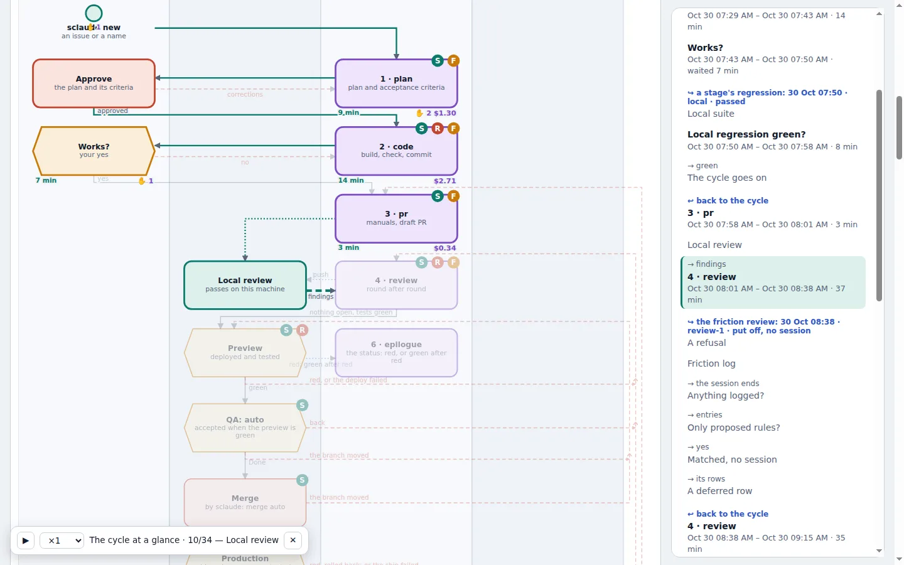
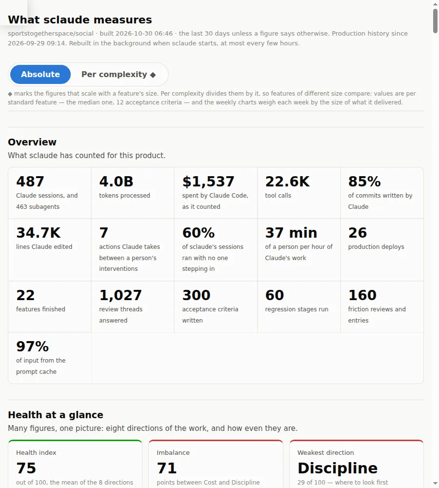

# SClaude

**Manageable, scalable AI coding for a team.** An orchestrator for Claude Code
that takes a feature from issue to production on one fixed path: the agent
does the typing, the harness keeps the process, and a person makes every
decision that matters.

> AI speed is easy to buy. Control is what has to be designed.

[What it solves](#what-it-solves) ·
[See it](#see-it) ·
[In the industry's words](#what-this-is-in-the-industrys-words) ·
[Get started](#get-started) ·
[Documentation](#documentation)

**Watch a real feature go through it** — a 7-minute walkthrough, and the story
of why sclaude exists:

https://github.com/user-attachments/assets/74c2ccd0-c63f-4860-b814-7b8d606e01f9

## Why it exists

Give a team an AI coding agent and within a few months it is no longer one
team. A few people are ahead of the whole planet; others barely keep up. The
leaders have no time to teach — a developer's job is to develop, not to
mentor — and each of them spends about half their time, and their tokens,
building the same private tooling, falling into holes a neighbour climbed out
of long ago. A zoo of bicycles, each just about coping with its owner's tasks.

And prompts are not guarantees. Even with every IMPORTANT in capitals, a model
invents a status, switches language, skips a predefined option, and over time
the process drifts.

sclaude is what came out of fixing both: the process moved into code, the
tools moved into the company's git, and the model was left with what a model
is actually better at — planning, writing and reviewing code.

## What it solves

### 1. Security — every stage of the AI gets exactly the tools it is allowed

- **A session per stage, each with its own permissions.** Planning cannot
  write code at all. Coding cannot merge. Nothing can push to `main`,
  force-push, skip a hook, promote a migration or switch to production.
- **Rules are executable, not advisory.** Hooks refuse a forbidden command at
  the moment the agent tries it. Merge and production stay a person's call,
  asked with no default answer.
- **A mistake stays inside one feature.** Each one runs in a sandbox of its
  own — a copy of the repository, its own dev server and address, its own
  database, its own preview. A failed release is rolled back without touching
  anybody else's.
- **Rules come in layers** — sclaude's core that nobody lifts, presets for the
  stack (Vercel, Supabase), the team's, the developer's. Tight by default,
  loosened by evidence: every refusal is logged and reviewed.

### 2. Scale and repeatability — one core process, with room to bend it

- **One fixed path for every feature**: plan → code → pull request → review →
  QA → merge → production → epilogue → retrospective. A step closes on
  evidence — an approved plan, green tests, a real pull request — never on a
  model saying "done".
- **One copy for everybody.** Nobody forks. Every command looks at the latest
  version first, so a fix reaches the whole team at their next command.
- **Room for personal add-ons.** The product describes itself in one file;
  the team and each developer add their own rules and prompts on top, and
  hand decisions — QA, merge, shipping — to the machine when they trust it.
- **The core itself is open to change.** A lesson climbs as far as it proves
  itself: one developer's rule → the team's → sclaude's default for every
  product. A session that runs into a flaw in sclaude fixes it and sends the
  fix back, reviewed, on the person's word.

### 3. Shared knowledge instead of reinvented bicycles

- **One set of tools in the company's git**, used and improved by everyone,
  instead of each developer building their own phone access, laptop
  keep-alive and AI review.
- **The process, the prompts, the rules and the lessons live in git**, where
  they compound instead of walking out of the door with the person who knew.
- **Knowledge flows without making anybody a mentor.** Time spent on tools
  turns into conversations — *why does your tool do it differently?* — and a
  new hire starts with everything the team has learned; `sclaude doctor` sets
  up their machine.

### 4. Fewer tokens — everything repeatable moved out of the agent

- **If a script can do it, the model should not.** Remembering where each
  feature stands, gathering context, sandboxes, tests, deploys, rollbacks,
  the issue and the board: all of it runs in the harness, at zero tokens.
- **A fresh session per step.** Only the approved plan and its criteria are
  carried forward; nothing stale is paid for on every message.
- **The right model per step** — the strongest with high effort for
  planning, a cheaper one for the pull request, none at all for deploys and
  gates.
- **Context managed for you.** A review round stays in the same session while
  its prompt cache is warm and moves to a fresh one when that is cheaper;
  noisy work goes to sub-agents; the review does not chase every finding.
  What each feature, step and review pass cost is counted.

The token know-how that used to live in one person's head, as six habits —
most of them built into the flow, the rest shared as team practice:

| habit | why it saves | |
|---|---|---|
| **The cache lives an hour** | a subscription keeps the prompt cache for an hour (five minutes on credits or an API key); warm, the context is re-read at a tenth of the price or less, cold, it is paid in full. Take on no more parallel features than you can answer within the hour | team habit |
| **A fresh session per step** | stale context is paid for on every message; starting clean costs nothing, while compacting a long conversation is itself a large request | built in |
| **The right model per step** | the strongest model where judgement matters, a cheaper one for the pull request and the write-up, none for deploys and gates | built in |
| **Scripts before tokens** | deterministic work runs as scripts; a hook can cut a ten-thousand-line log to its failures before the model reads it | built in |
| **Lean always-on context** | CLI tools rather than MCP servers, workflow instructions as skills that load on demand, CLAUDE.md under 200 lines | team habit |
| **Delegate the noisy parts** | sub-agents keep long outputs out of the main context; agent teams cost about seven times a single session | built in |

### 5. Retrospectives that coach you one-to-one, and metrics nobody fills in

- **A personal retrospective after every feature.** It reads the recording of
  the whole run and tells *you*, from *your* run: what you may have missed,
  how you could work better, what went well, what sclaude could do better.
  Every point quotes a line or names a file. Facts, not opinions.
- **Not a lecture from above.** A senior's verdict from on high makes people
  defend themselves and hide from oversight. A token leaderboard makes them
  burn tokens to climb it. Here you replay your own feature and think about
  yourself — nobody else is judging.
- **Gamified, by accident.** Every finished feature plays back as an
  animation on the process map: each step in turn, its minutes, its prompts,
  its cost. People watch it again and again, and start asking why it went
  the way it did.
- **Metrics with no overhead.** Not a single field to fill in. DORA's four
  keys, the pull request's way, quality, flow, how autonomous Claude was and
  what it cost — collected as a by-product of a process that helps the
  developer, not one that watches them.

### Step away from the desk — the work keeps going

The phone is a channel to the orchestrator. Every question goes to the
terminal and to your own Telegram bot at once, and whichever you answer first
counts; the feature running on the laptop opens full screen inside Telegram;
the laptop stays awake only while there is work. Most phone moments are look,
tap, done:

| the moment | the classic way: VPN + SSH | with sclaude's bot |
|---|---|---|
| see the feature | turn on the VPN, recall the IP and port, open the browser | tap **Open on phone** |
| restart the dev server | SSH in, find the terminal, stop it, start it again | tap **Stop**, then **Open**: it starts on the visit |
| "is the step done?" | SSH in, attach to the session, type the answer | tap **Yes**; the terminal at home carries on |
| the laptop is about to sleep | walk back to it, or lose the session | the bot asks 30 minutes ahead; tap **Extend** |
| where is everything? | check each terminal tab in turn | one card per feature: running, waiting, idle |
| something odd | the classic way | still the classic way — it is kept as the spare key |

### And more

- **Demo videos, recorded by the agent.** Each feature is clicked through as
  its users, with captions on what to look at, and the video lands on the
  issue for QA.
- **Night mode.** Go to sleep; Claude carries on, decides instead of asking,
  and gives you a summary of its decisions in the morning.
- **Built for the bad days.** Red tests get a fixing session, twice, then a
  person. Red production is rolled back first — unless somebody else shipped
  since. A closed laptop or a usage limit loses nothing.

## See it





**Presentations.** Slide decks for whoever decides whether a team should adopt
all this — a CTO, a lead:

| deck | what it covers |
|---|---|
| [`vibe_coding_story.html`](docs/presentations/vibe_coding_story.html) | why sclaude exists: a team fragmented by uneven AI skills, everyone building the same tools, putting them in the company's git, metrics with no extra work |
| [`sclaude_in_details.html`](docs/presentations/sclaude_in_details.html) | sclaude in depth: the fixed path, gates on evidence, rules in hooks, the feedback loops, AI review done deliberately, the team setup |
| [`sclaude_instruments.html`](docs/presentations/sclaude_instruments.html) | the stack for a PoC or an MVP and why each tool is in it; the whole cycle from a phone |
| [`sclaude_full_story.html`](docs/presentations/sclaude_full_story.html) | all three in one: the problem, the orchestrator, the tools around it |

Each is one self-contained page: open it in a browser from a checkout (GitHub
shows the file's source) and page through with the arrow keys.

**The process map.** [`bpmn_diagrams.html`](docs/presentations/bpmn_diagrams.html)
draws sclaude's cycle as BPMN — every lane, every way back, every command and
where it leads — built from the same model the tests check against the code,
so the map never drifts from what actually runs. Interactive, and printable on
A4. Each feature gets its own copy with where it stands lit, and its whole
history can be played back on it.

**Video.** The 7-minute walkthrough of a real feature is
[at the top](#sclaude) and in the [v1.0 release](https://github.com/personalautomation/SClaude/releases/tag/v1.0).
And every feature comes with videos of its own: step 2 records a demo of what
was built — a video per scenario, on a desktop and a phone, with the steps
beside it and a link to take over from any of them by hand
([skills/sdemo](docs/tools.md#skillssdemo)).

## What this is, in the industry's words

`sclaude` is **spec-driven development** with an agent doing the typing, and
**the 3Cs** — contain, curate, control — as the safety model.

Neither label was chosen to sound current. SDD is the shape the industry
converged on during 2026, after vibe coding ran into multi-file drift and
constraints agreed in session one were forgotten by session three. The 3Cs are
Docker's framing of agent security: bound the blast radius, build the
environment the agent works in, enforce the rules as actions happen. This
repository was built to both shapes before either had a name.

### The loop: specify → clarify → plan → implement → verify

sclaude's cycle is made of steps, each a fresh Claude session, so nothing gets
lost in an overgrown conversation. SDD's five names fall across them unevenly:

| step | in SDD's words | what happens |
|---|---|---|
| **1. plan** | specify, clarify, plan | Claude reads the issue and the product's manuals, says what it thinks the scope is and waits for you to correct it, then writes a plan with acceptance criteria for you to approve |
| **2. code** | implement, verify | Claude builds it, checks it in a browser, and the product's tests must pass |
| **3. pr** | — | the pull request, and the manuals updated to match |
| **4. review** | verify | an automatic review of the pull request; Claude fixes what it finds; a preview deployment and its tests; then QA, the merge and production |
| **5. sync** | — | only when the reviewed branch does not merge with main: Claude merges main in, resolves the conflicts and pushes, and the preview and QA see the result |
| **6. epilogue** | — | after production: the outcome written into the issue and its parents, so an epic shows where it stands |
| **7. retro** | — | before the feature is cleaned up: what you may have missed, how you could work better, what sclaude could do better |

When tests fail, a separate session fixes them. After every step's session, every
sync with main and every fixing session a short
**friction review** looks at what sclaude's safety rules refused, and loosens a
rule that was in the way.

**Acceptance criteria are a gate, not a request.** Step 1 does not close until
the approved plan has them. They are written into the issue, every later step
works against them, and QA ticks them off there. Testable criteria before any
code exists is what shift-left asks for.

### Contain — the blast radius of a mistake

Every feature gets its own copy of the repository (a git worktree), its own dev
server at its own address, and, where the product supports it, **a database of
its own**. A migration written for one feature cannot reach another, and a
database reset wipes nobody else's data.

### Curate — what the agent can see and reach

The agent's world is set up before it runs. Each step has its own model and
permissions; in step 1 Claude cannot write code at all. What the product is —
its tests, its manuals, its environments, its board — the product describes in
one config file, so sclaude assumes nothing about anybody's repository.

### Control — the rules apply as the action happens

sclaude refuses these commands at the moment a session tries them:

- **merging a pull request** — that is a person's decision;
- **pushing to the product's `main`**, force-pushing, skipping the pre-push hook;
- **promoting migrations to production**, **switching to the production
  environment**;
- **writing code during planning**;
- **deploying to production** without asking: sclaude asks you, with no
  default, and words it "Ship to production **anyway**?" when QA never saw the
  feature.

These rules catch mistakes, not a session determined to get round them: a
command written to a file and run from there is beyond what they can see. If
your GitHub plan offers branch protection (free on public repositories, paid on
private ones), turn it on for `main` as well: require a pull request and allow
no direct pushes.

### Quality gates, in the Definition-of-Done sense

- **A step closes on evidence**, never on a model saying "done": an approved
  plan with criteria, your yes and green tests, a pull request that exists,
  a review with nothing left open.
- **The product's tests run at up to four points**: locally, on the preview,
  on production, and once more after a production rollback.
- **No endless loops.** A red run is run once more by itself, since the
  commonest red is a flaky test; then a fixing session, at most twice; then a
  person is asked.
- **Red production is rolled back first**, and the old release checked —
  unless somebody else shipped since: that release is not ours to remove.

The whole list of what closes each step is in
[How the cycle is kept in line](docs/cycle.md).

### Review is an agent's, the merge is a person's

This is Anthropic's own
division of labour for Claude Code Review — *"It won't approve PRs — that's
still a human call"* — and their reported effect is the argument for it:
before, 16% of pull requests got substantive review comments; after, 54%.
sclaude prepares the decision: the acceptance criteria as QA left them, the
checks, the review's findings with what was done about each, in one place.

### Where the claims come from

- [Vibe coding vs spec-driven development](https://www.augmentcode.com/guides/vibe-coding-vs-spec-driven-development) — what SDD is, and the 3–10× first-pass rate its adopters report.
- [Spec-driven development in 2026](https://devtoollab.com/blog/spec-driven-development-ai-agents) — the five-part loop, and Karpathy closing the vibe-coding era.
- [The 3Cs: a framework for AI agent security](https://www.docker.com/blog/the-3cs-a-framework-for-ai-agent-security/) — contain, curate, control. "Curation isn't approval. It is construction."
- [Code Review for Claude Code](https://claude.com/blog/code-review) — Anthropic on the same division of labour, and what it changed for them: substantive review comments on 16% of pull requests, then 54%.
- [Agent security and evaluation](https://github.com/war851/SDLC/blob/main/_foundation/google-agents-vibecoding-jun2026/day-4-vibe-coding-agent-security-and-evaluation/day-4-vibe-coding-agent-security-and-evaluation.md) — sandboxing, least privilege, human-in-the-loop for high-stakes actions, and the seven dimensions worth evaluating.
- [Git worktrees + Claude Code](https://www.developersdigest.tech/blog/git-worktrees-claude-code-parallel-agents-guide) — four to eight parallel worktrees per developer as the working norm.
- [DORA benchmarks](https://www.gitrecap.com/blog/dora-metrics-benchmarks) — what the records written here are meant to feed.
- [Coherence through orchestration](https://mikemason.ca/writing/ai-coding-agents-jan-2026/) — the warning worth reading first: alongside AI adoption, Google's DORA research found bug rates up 9%, review time up 91%, pull requests 154% larger. Gates on results and refused commands are the answer to exactly that.

## Private by design

- **No telemetry.** sclaude sends nothing to its authors: no usage
  statistics, no crash reports, no analytics.
- **Your services, your logins.** What it sends goes only where your work
  already goes: Anthropic (as with any Claude Code use), your product's
  GitHub, your deploy target, and your own Telegram bot if you set one up.
- **Your data stays on your machine.** Session transcripts, terminal
  recordings, each feature's history and its metrics stay local (unless
  you name a team repository to gather the metrics in); the working files
  are kept out of git and out of every deployment.
- **Nothing is exchanged with this public repository unless you choose
  it.** Taking updates and sending fixes back are each a setting you pick at
  install; a
  fix is checked for your product's details first, and by default nothing
  leaves without your yes.
- **Nothing listens on the internet.** The per-feature addresses answer only
  your machine and your private network; the phone's gate opens only while
  you have phone access turned on.

The full account is in [Privacy](docs/privacy.md).

## Who it is for, and what it costs

| | |
|---|---|
| **Fits** | small teams with a product of their own — Next.js on Supabase and Vercel, developers on Linux or Windows with WSL2 ([the environment](docs/setup.md#the-environment-it-is-built-for)) |
| **Infrastructure** | ≈ 0: free tiers carry a PoC, and the laptops are already paid for. No server in between |
| **Main line item** | the Claude subscription per developer — which lean context per step keeps in check |
| **Onboarding** | one script, then `sclaude doctor` lists what a machine still lacks and the command that fixes each gap |
| **Privacy** | no telemetry; what it sends goes to your own services ([details](docs/privacy.md#privacy-what-leaves-your-machine)) |
| **Licence** | MIT — free for any use ([what that means](#free-and-open-mit)) |

Observed in the team that runs it: a 10–20% productivity improvement and
about 5% fewer tokens in the first weeks — project observations, not
universal benchmarks. macOS is not supported yet.

## Get started

```bash
git clone git@github.com:personalautomation/SClaude.git ~/sclaude
cd ~/sclaude && ./install.sh
sclaude doctor          # what this machine still lacks, and how to fix it
cd <your product> && sclaude new
```

The first `sclaude new` in a product offers to write its config, read from
what is already there. The details are in [Installation](docs/setup.md#installation).

## Documentation

| read | for |
|---|---|
| [Setting up](docs/setup.md) | the environment sclaude is built for, what is required and what is optional, and the installation |
| [Using sclaude](docs/sclaude-guide.md) | every command, and a feature from start to finish |
| [How the cycle is kept in line](docs/cycle.md) | what closes each step, what is refused, the gates, the rollback, what is measured, the decisions a product may hand to sclaude |
| [For a team](docs/team.md) | one copy for everybody, the product's config, layered rules, who changes the orchestrator |
| [Privacy](docs/privacy.md) | what leaves your machine, what stays, what listens |
| [The tools](docs/tools.md) | the skills (`/pr`, `/sreview`, `/sdemo`, `/isleep`), the per-feature proxy, chrome-debug, keepawake and its Telegram bot, the rest |
| [The decks and the process map](docs/presentations/README.md) | building the decks, printing the map |
| [docs/sclaude.md](docs/sclaude.md), [docs/keepawake.md](docs/keepawake.md) | how the parts work inside, and why they were built that way |

Everything written in this repository is in English; see `CLAUDE.md` for the
rule and its three deliberate exceptions.

## Free and open: MIT

sclaude is under the [MIT licence](LICENSE). In plain words:

- **Use it for anything** — your company, your clients, a commercial product.
- **Change it however you like** — fork it, rewrite it, strip it down, build
  your own process on top of it.
- **Keep your changes to yourself** if you want: nothing obliges you to send
  them back, publish them or open your code.
- **Ship it, sell it, bundle it** — in proprietary products too.
- **Owe nobody anything** — no fees, no royalties, no sign-up, no permission
  to ask.

The one condition: keep the copyright and licence notice in copies of it. It
comes as it is, with no warranty.

## Contributing

Contributions are welcome all the same. [CONTRIBUTING.md](CONTRIBUTING.md) is
the short way in: connecting a product, what lives in its `.sclaude/`,
proposing a change to sclaude and running the tests.
