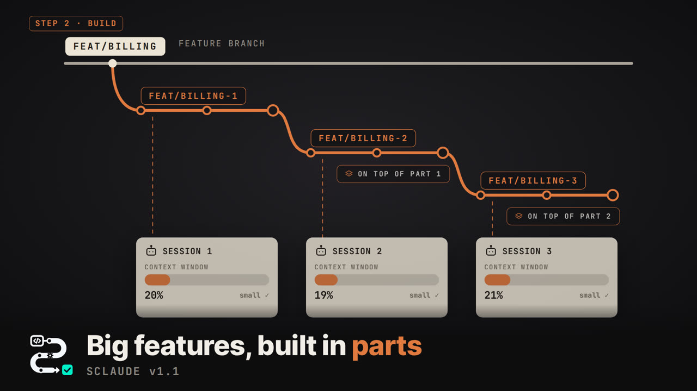

# Big features, built in parts (v1.1)

[](https://github.com/user-attachments/assets/05147af1-635f-471e-849c-bf1b25c7391f)

Some features are simply big: ten thousand changed lines or more. That is
exactly where AI coding starts to hurt.

1. **Context.** A big feature fills Claude Code's context window, the session
   gets compacted, and earlier decisions get lost.
2. **Cost.** Every step re-reads everything in the context, so the longer the
   session, the more each step costs.
3. **Review.** Nobody really reviews a ten-thousand-line pull request — not a
   person, not an AI. Quality drops, bugs slip through.

The usual advice is to split the feature by business requirements into
smaller features, each shipped on its own. We still recommend it when it makes
sense. But some features are one natural whole: cut one only so it fits a
session, and you keep the boundary in your head in every review and test,
preview and release each piece separately. Today a person's time and focus
matter most, and that is exactly where things get missed.

**In SClaude we try to remove the complexity, not move it.** A big feature
stays one feature: **one issue, one plan, one QA**, built in parts.

## How it works

**Step 1 offers the split.** When the plan is over about 10,000 changed lines,
step 1 offers to build it in parts, and you decide. Parts are **slices across
the feature, not layers**: not "the schema, then the API, then the screens",
but working pieces of behaviour. Each part works on top of the ones before it,
with green tests.

**Step 2 builds the parts one by one.** Each part gets a fresh session with a
small context, on its own branch, stacked on the part before it. Small context
means lower cost and sharper code: no compaction, no lost decisions. Before a
part closes, a fresh subagent reads its diff and looks for what would cost
more to fix later. Ask for a change meanwhile, and the session decides where it
belongs: now, or in a later part.

**You check the whole feature once.** One demo, one Accept. Only then does
review start. Why after Accept? Because a demo often brings changes, and after
any change every review has to be done again.

**Each part is reviewed alone, in order.** The pull requests are nested: each
part's PR targets the feature branch, and the feature's PR targets `main`.
Before a part's PR opens, its branch takes in the reviewed part before it, so
the diff shows that part alone. A small pull request gets a real review.

**The feature's PR into main reads the seams.** Preview, QA and production
happen once, for the whole feature. If an earlier part's review fix conflicts
with a later part, a sync session merges it and keeps what the review decided.

```
main ◄── feature PR (reads the seams; preview, QA, production once)
           ▲
   feat/<slug> ◄── part 1 PR ◄── part 2 PR ◄── part 3 PR
                   (each reviewed alone, in the order built)
```

**The result:** small contexts, lower cost, real reviews — and for you, still
one feature to test.

## Controls

- The menu shows where the parts are: `2/7 development · part 2/3` while they
  are built, `4/7 review · part 2/3` while they are reviewed.
- `partAccept: each` in `sclaude config` ends each part on its own demo and
  Accept, if you want to see every part.
- `sclaude parts <name> stop` ships the feature with the parts built so far;
  the rest become an issue of their own.
- Before each part's pull request and merge, SClaude checks that GitHub still
  holds the parts as it left them, and stops with what to do if not.

## Read more

- [The v1.1 release](https://github.com/personalautomation/SClaude/releases/tag/v1.1)
- [Step 1 and the split, in the guide](https://github.com/personalautomation/SClaude/blob/main/docs/sclaude-guide.md#a-feature-start-to-finish)
