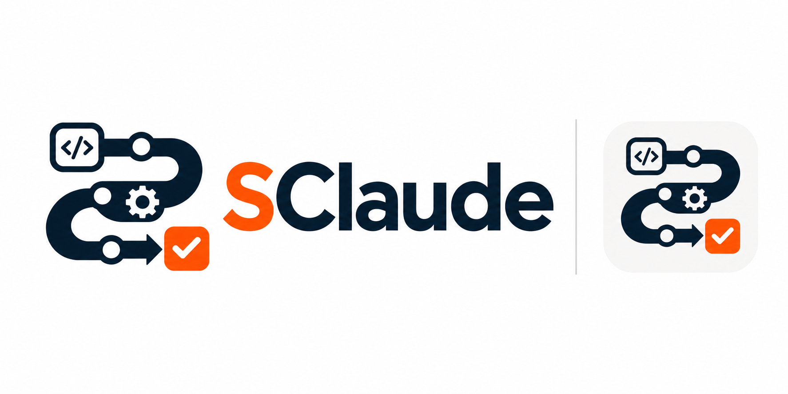
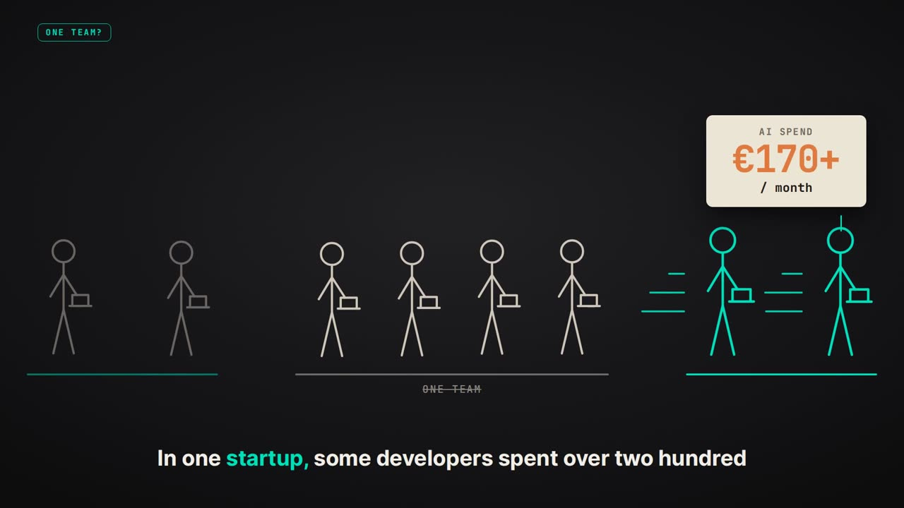
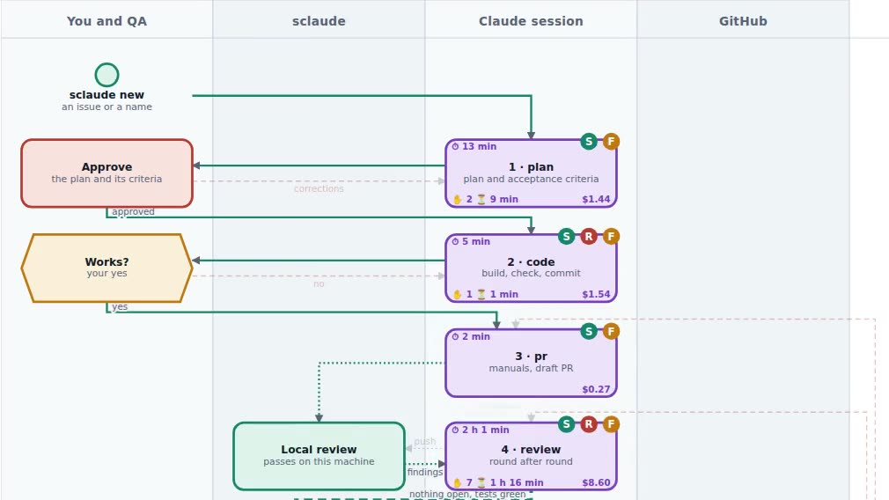

<p align="center"></p>

# Manageable, scalable AI coding for a team

**SClaude is an orchestrator for Claude Code.** It takes a feature from issue
to production on one fixed path. The agent does the typing, the orchestrator
keeps the process, and a person makes every decision that matters.

> **AI speed is easy to buy. Control is what has to be designed.**

Open source, MIT, free for any use. No telemetry: your code and data stay on
your machines.

[Repository](https://github.com/personalautomation/SClaude) ·
[Landing page](https://personalautomation.github.io/SClaude/) ·
[Get started](Getting-Started) ·
[Latest release: v1.1, big features built in parts](https://github.com/personalautomation/SClaude/releases/tag/v1.1)

## Watch first

| What it is and why · 7 min | A real feature, start to finish · 7 min |
|---|---|
| [](https://github.com/user-attachments/assets/0f322031-5667-4bc7-a581-47819db40531) | [](https://github.com/user-attachments/assets/74c2ccd0-c63f-4860-b814-7b8d606e01f9) |

## The problem: a zoo of bicycles

Give a team an AI coding agent, and within a few months it is no longer one
team. In one startup, some developers spent over **€200 a month** on AI while
others used **less than a quarter** of a €100 plan. Paying more did not mean
shipping more: the leaders simply understood how AI thinks.

To go faster, the leaders built automation tools, only for themselves, and
spent **about half their time** on it. Every company we looked at got two
problems at once: a big cost, and a zoo of tools that all do the same thing,
slightly differently, and fall into the same holes.

Those who do build a shared harness usually build it out of the agent itself:
a crew of AI agents, a set of skills, a tree of markdown instructions. It looks
great in a demo. But **instructions are advice, not guarantees**. Even with
IMPORTANT in capitals, a model invents a status, skips a step, and over time
the process drifts. And it spends tokens on work a simple script would do for
free.

**[The whole story →](Why-SClaude)**

## The answer: the process in code, the thinking with AI

Whatever repeats or has to scale moves into scripts. Thinking stays with AI,
in a session with a context prepared just for it, and with limits it cannot
break. Those limits live in code, not in prompts. That gives you four things.

### 1. Predictable delivery

Every feature goes the same path: **plan → code → pull request → review → QA →
merge → production → epilogue → retrospective**. A step closes on evidence (an
approved plan, green tests, a real pull request), never on a model saying
"done". Red tests get a fixing session, then a person; red production is
rolled back first.
**[The cycle →](The-Cycle)** · **[Big features, built in parts →](Big-Features-in-Parts)**

### 2. Control

People decide the scope, the merge and production. Each step gets only the
tools it needs, and a hook refuses a forbidden command the moment the agent
tries it. *A prompt is a request. A hook is a lock.* Every feature runs in its
own sandbox (its own copy of the code, dev server and database), so a mistake
stays inside one feature.
**[Limits in code, not in prompts →](Limits-in-Code)**

### 3. Fewer tokens

If a script can do it, the model shouldn't. Tests, deploys, rollbacks, the
issue and the board all run at zero tokens. Each step starts a fresh session
with the right model for the job.
**[Where the tokens go →](Fewer-Tokens)**

### 4. Data for free

Everyone follows one process, so metrics are collected automatically, with
not a single field to fill in. A lead sees cost, speed and quality without a
status meeting. Every finished feature plays back as an animation, and people
replay it like a game. No token leaderboards: you only compare yourself with
yourself.
**[Metrics and the replay →](Metrics-and-Replay)**

## Feedback loops that keep the process comfortable

A process only works if it's comfortable; otherwise people work around it.
SClaude ships three loops:

- **Friction review**, after every step: what the safety rules refused, and
  whether a rule got in the way. Start tight without fighting the tool.
- **Monthly review**: everything deferred, counted across features. One
  refusal is an anecdote; the same one in five features is a pattern.
- **Retrospective**, after each feature: from *your* run, what you may have
  missed, how you could work better, what went well. Facts, not opinions, and
  nobody else is judging.

**[Feedback loops →](Feedback-Loops)**

## One developer or a whole team

Alone, you get the whole process from day one. In a team there is **one copy
and one standard for everybody**, so a fix reaches everyone at their next
command. Tools, prompts and lessons live in the company's git, so knowledge
spreads without making anybody a mentor. *A developer's job is to develop.*
Rules come in layers, from SClaude's core to each developer's own, with your
prompts on top.

**[For a team →](For-a-Team)**

## Step away from the desk

Every question goes to the terminal and to your own Telegram bot at once; the
first answer counts. The feature running on your laptop opens full screen
inside Telegram, and the laptop stays awake only while there is work.

**[Working from the phone →](Working-from-the-Phone)**

## Who it fits, and what it costs

| | |
|---|---|
| **Fits** | small teams with a product of their own: Next.js on Supabase and Vercel, on Linux or Windows with WSL2 |
| **Infrastructure** | ≈ 0: free tiers carry a PoC, and the laptops are already paid for |
| **Main line item** | the Claude subscription per developer, kept in check by lean context per step |
| **Onboarding** | one script, then `sclaude doctor` lists what a machine lacks and how to fix each gap |
| **Observed in the team** | 10–20% productivity improvement, about 5% fewer tokens in the first weeks (project observations, not benchmarks) |

**[The stack and the costs →](Stack-and-Costs)** · **[Privacy →](Privacy)**

## Start in four lines

```bash
git clone git@github.com:personalautomation/SClaude.git ~/sclaude
cd ~/sclaude && ./install.sh
sclaude doctor          # what this machine still lacks, and how to fix it
cd <your product> && sclaude new
```

**[Getting started →](Getting-Started)**

## Go deeper

| | |
|---|---|
| **How it works** | [The cycle](The-Cycle) · [Big features in parts](Big-Features-in-Parts) · [Limits in code](Limits-in-Code) · [Fewer tokens](Fewer-Tokens) · [Feedback loops](Feedback-Loops) · [Metrics](Metrics-and-Replay) · [For a team](For-a-Team) · [The phone](Working-from-the-Phone) |
| **Guide** | [Setting up](Setup) · [Using sclaude](Using-sclaude) · [A feature, start to finish](Using-A-feature-start-to-finish) · [Gates and rules](Gates-and-Rules) · [Team setup](Team-Setup) · [The tools](Tools) · [Contributing](Contributing) |
| **Inside** | [How sclaude works, and why](Inside-sclaude) · [How keepawake works, and why](Inside-keepawake) |
| **See it** | [Videos and decks](Videos-and-Decks) · [The process map](https://personalautomation.github.io/SClaude/presentations/bpmn_diagrams.html) · [Landing page](https://personalautomation.github.io/SClaude/) |

## Two pieces of advice, whether you use SClaude or not

1. **Build feedback loops into your orchestrator.** A process only works if
   it's comfortable.
2. **Give the team one shared tool and let everyone contribute.** To make it
   fit, people have to talk, and while they argue and agree, their processes
   line up. Before, a zoo of bicycles; now, cars on a road.

**[The advice in full →](Advice)**

---

SClaude is open source. If you want the same approach for your own process,
stack and architecture, [get in touch](https://personalautomation.github.io/SClaude/contact.html).
