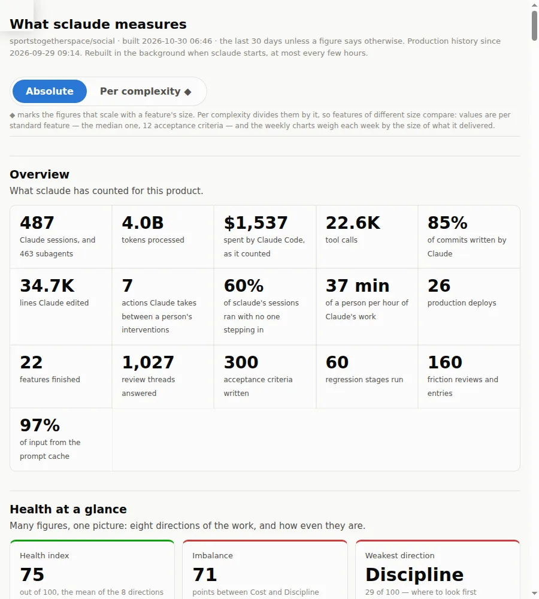

# Metrics and the replay

> **Not a single field to fill in.**

Metrics that cost developers work are metrics nobody keeps honestly. In
SClaude everyone follows one process, so the data is a by-product of a process
that helps the developer, not one that watches them.

## What is collected, automatically

- **DORA's four keys** from real cycles: deployment frequency, lead time,
  change failure rate (rollbacks are found by themselves), time to restore.
- **Per feature**: time per step, test attempts and what failed, friction and
  what each review decided, review findings and responses, how far it shipped.
- **Tokens and cost**: per feature, per step, per review pass, and the cache
  hit rate — the one that saves the most.
- **How autonomous Claude was**: how many manual interventions a feature
  needed, and the share of commits Claude wrote.

A lead reads a summary table in each issue, and sees cost, speed and quality
without a status meeting. Optionally, each person's records are gathered in a
team repository.

## The replay: gamified, by accident

One of the most exciting parts of vibe coding is watching code being written.
Replaying your own feature is even nicer. Every finished feature plays back as
an animation on the process map: each step in turn, its minutes, its prompts,
how long the AI waited for you, its cost.

▶ **Watch** → ↻ **Replay**, again and again → **?** **Think**: *why did this
feature take so many steps? Why so long? What can I do better?*

People start it as a game and end up thinking about how to improve.

## The review's map: when to stop reviewing

Writing code with AI is cheap; reviewing it is slow and expensive, and
stopping too early or too late are both costly. Under the review step the
page shows the review as a map: on top all the code the development wrote,
a column per file, and below a band per round. From the code hang icicles —
each place the review kept sending fixes to, a band a round as wide as the
lines it changed there: narrowing as fewer are touched, widening as review
draws in more code or another file, merging and splitting as places meet
and part, stopping where review stopped coming back. Code that was not part
of the development has nothing above it: its icicle starts in the middle of
the review. An icicle follows one problem, not a stretch of the file: once a
round has read a fix and found nothing, a problem found later nearby starts
an icicle of its own — unless it sits on the very lines that fix wrote, a
check that missed, which the map marks in purple. Its colour says how the thread ended (fixed, declined, left to you, would
undo a fix), with the share the person asked for during the
review in the development's beige, and code merely moved from one file to
another in its own muted colour, counted apart from the fixes; it darkens
the more often review had already rewritten those lines; rows where nothing
happened to an icicle are a thin stem, and a removed file ends its icicle
with a ✕; a pattern marks a migration among changed code,
and a place where neither code nor a migration changed is hollow, its
patterns saying what was touched instead: tests, docs and config, comments. A green line under a file in a round's row says that
round read it and found nothing (blue and thin: only the last fixes;
yellow and dashed: a part), so a run of rounds that each found nothing anywhere shows. Beside the round names one icicle sums them all: left of its axis the development's code a round touched, right the code review itself had written — leaning right, review is polishing its own work — and a line for how much the round grew or shrank the code. Threads pile up as dots where review found many, all one size, with +n for those past the row. ✋ marks each time a person stepped in, ringed where
they took the recommended answer. A round of a pull request read in review
blocks is named by its block — "Block 3 · round 7 (131)" — with, in brackets,
its row in the terminal's review report, and every mark on the map says on
hover what it means. Played back, the map grows round by round.

The same review can be read by thread instead of by place: a tree growing
from the pull request, a column a round, each thread a line from the fix it
was found on to its own fix, a fix a circle as large as the lines it
changed. A finding posted on the lines an earlier fix wrote is that fix's
child, so the tree shows which fixes bred new problems and which were read
again and left alone (✓). With chains on one row, a problem that kept
coming back to one place of the code is one long straight row, marked ×N.

It is a diagnosis, not a cure: it shows which parts of the code have had
enough review and which are still worth it, and leaves the decision with
the person.

## Why not a leaderboard

| others | SClaude |
|---|---|
| **Token leaderboards.** Meta took its board down; Amazon closed its own after people burned tokens to climb it | you replay **your own** feature. You compare yourself only with yourself |
| **Champions made to mentor.** For leaders it is not their real job, and those who get such feedback all the time become defensive | mentoring is somebody else's duty. Developers are not distracted, and knowledge is shared without anyone noticing |
| **Analytics for management** | data is a by-product of a process that helps the developer |

A senior's verdict from on high makes people defend themselves and hide from
oversight. Here you think about yourself, and nobody else is judging.

## Read more

- [What is measured](https://github.com/personalautomation/SClaude/blob/main/docs/cycle.md#what-is-measured)
- [The process map](https://personalautomation.github.io/SClaude/presentations/bpmn_diagrams.html)
- [Feedback loops](Feedback-Loops) — the retrospective that coaches you one-to-one
