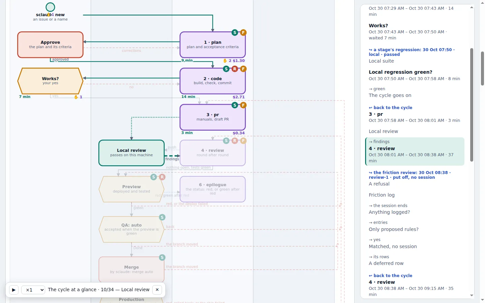

# The cycle: one feature, one fixed path

Every feature takes the same path. Each step is a **fresh Claude session** with
its own model, permissions and exit condition; only the approved plan and its
acceptance criteria are carried forward.

| step | what happens | closes only on |
|---|---|---|
| **1 · plan** | Claude reads the issue, its parents and the product's manuals, says what it thinks the scope is and **waits for you to correct it**, then writes a plan with acceptance criteria. No code at all | a plan a person approved, with criteria |
| **2 · code** | builds it in the feature's sandbox, checks it in a real browser, records a demo, asks you to accept | your Accept and green tests |
| **3 · pull request** | updates the manuals, writes the pull request | a pull request that exists on GitHub |
| **4 · review** | AI review and CI; Claude fixes findings round by round; preview deploy and its tests; then QA, the merge and production | nothing left open, preview tests green |
| **5 · sync** | only when the reviewed branch no longer merges with main: Claude merges main in and resolves the conflicts | a clean merge, preview and QA re-run |
| **6 · epilogue** | after production, the outcome is written into the issue and every parent, so an epic shows where it stands | the session ran |
| **7 · retro** | before clean-up, reads the whole run: what you may have missed, how to work better, what SClaude could do better | the session finished |

QA (a person checks the preview and ticks the criteria in the issue) and the
merge (a person, with one decision surface) sit between review and production.

## Acceptance criteria are a gate, not a request

Step 1 does not close until the approved plan has criteria: `AC1`, `AC2`, …,
each something a person can check on a deployment without reading the code.
They go into the issue as a comment of their own; every later step works
against them; each commit names the criterion it serves; QA ticks them off in
the issue. Testable criteria before any code exists is what shift-left asks for.

## A step closes on evidence, never on "done"

A model saying it finished closes nothing. Ctrl-C, a usage limit or a closed
laptop closes nothing either: the state is kept outside the conversation, and
the same conversation resumes.

## Built for the bad days

| when | then | and then |
|---|---|---|
| **regression is red** (local, preview or production) | run once more (the commonest red is a flaky test), then a fixing session, at most twice | still red: a person is asked. No endless loops |
| **production is red** right after the release | roll back first — unless somebody else shipped since: that release is not ours to remove | a clean check of the old release |
| **the review in Actions cannot run** (Claude's limit, no Actions minutes, a runner without network) | rerun once the limit has reset | still blocked: `review: github` stops step 4 and says why; `github-local` reviews the feature on this machine |
| **QA sends it back** | the cycle rewinds to the step that must change | back through QA, same criteria, same issue |
| **a closed laptop** or a dropped connection | pick up where it stopped | nothing lost or redone |

**Every branch ends in something you can check, or in a question to a person.
Never in a loop, never in silence.**

## Review is an agent's; the merge is a person's

AI review goes wrong in four ways, and SClaude has an answer for each:

| failure | what SClaude does |
|---|---|
| **finds nothing** | the review must actually run on the latest commit; a green check that reviewed nothing is shown as such |
| **endless rounds** | a person's decision is recorded as "left as it is" and not raised again; a fix that would undo an earlier fix goes to the person |
| **burns tokens** | a small context with only the open threads; fixes go to sub-agents; the session stays only while its cache is warm |
| **stalls on a person** | the agent fixes and replies; you see only the few findings it disagrees with, as an explicit yes or no |

Then the person gets **one decision surface**: the criteria as QA left them,
the checks, the review's findings and what was done about each, in one place.
This is Anthropic's own division of labour for Claude Code Review — *"It won't
approve PRs — that's still a human call"* — which moved substantive review
comments from 16% to 54% of pull requests.

## Hand decisions to the machine when you trust it

QA, the merge and shipping are settings of the product. Start with a person at
each, and hand one to SClaude when the evidence says it is safe.

## Read more

- [Big features, built in parts](Big-Features-in-Parts)
- [Using sclaude](https://github.com/personalautomation/SClaude/blob/main/docs/sclaude-guide.md) — every command, a feature start to finish
- [How the cycle is kept in line](https://github.com/personalautomation/SClaude/blob/main/docs/cycle.md) — gates, refusals, rollback
- [The process map](https://personalautomation.github.io/SClaude/presentations/bpmn_diagrams.html) — the whole cycle as BPMN, built from the model the tests check against the code
