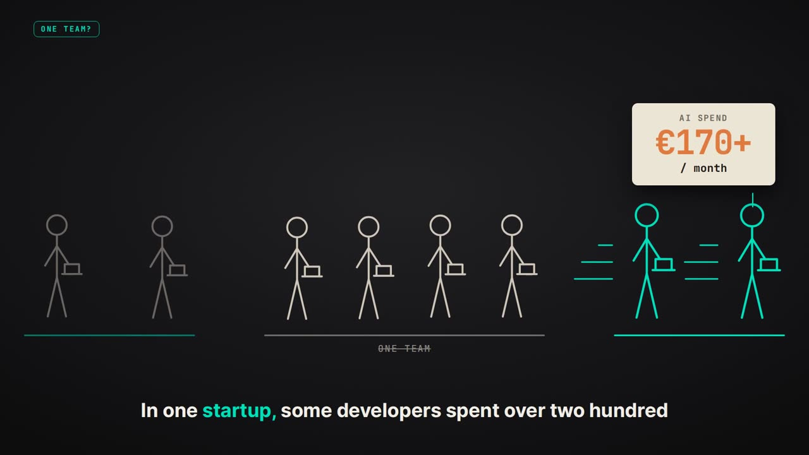
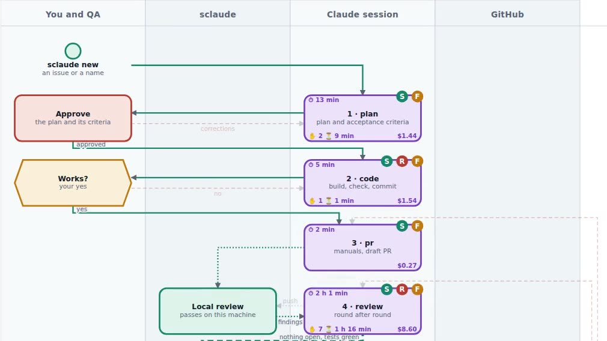

# Videos and decks

## Videos

| | video | what it covers |
|---|---|---|
|  | **What it is and why** · 7 min | the problem, why limits live in code, the four things you get, feedback loops, two pieces of advice |
|  | **A real feature, start to finish** · 7 min | a real feature through every step, the friction log, the retrospective, the metrics, how the idea came about ([v1.0](https://github.com/personalautomation/SClaude/releases/tag/v1.0)) |

## Decks

For whoever decides whether a team should adopt this — a CTO, a lead. Each
opens in the browser; page through with the arrow keys.

| deck | what it covers |
|---|---|
| [How SClaude began](https://personalautomation.github.io/SClaude/presentations/vibe_coding_story.html) | a team fragmented by uneven AI skills, everyone building the same tools, putting them in the company's git, metrics with no extra work |
| [SClaude in depth](https://personalautomation.github.io/SClaude/presentations/sclaude_in_details.html) | the fixed path, gates on evidence, rules in hooks, the feedback loops, AI review done deliberately, the team setup |
| [Build on a laptop, run it from a phone](https://personalautomation.github.io/SClaude/presentations/sclaude_instruments.html) | the stack for a PoC or an MVP and why each tool is in it; the whole cycle from a phone |

## The process map

[bpmn_diagrams.html](https://personalautomation.github.io/SClaude/presentations/bpmn_diagrams.html)
draws the cycle as BPMN — every lane, every way back, every command and where
it leads — built from the same model the tests check against the code, so the
map never drifts from what actually runs. Interactive, and printable on A4.

## The landing page

Everything here in one designed page: [personalautomation.github.io/SClaude](https://personalautomation.github.io/SClaude/).
